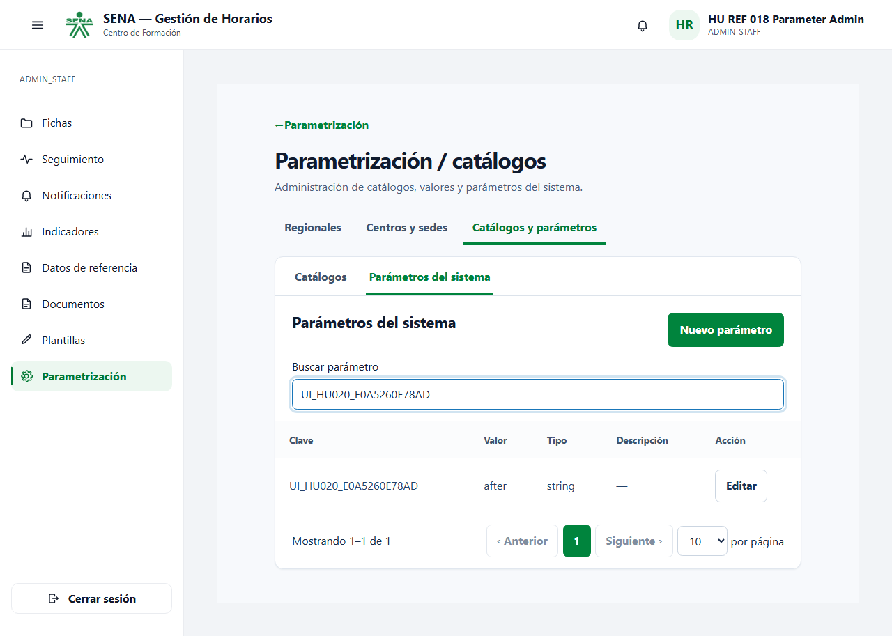
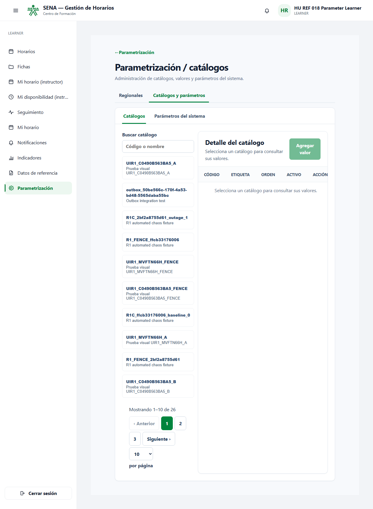
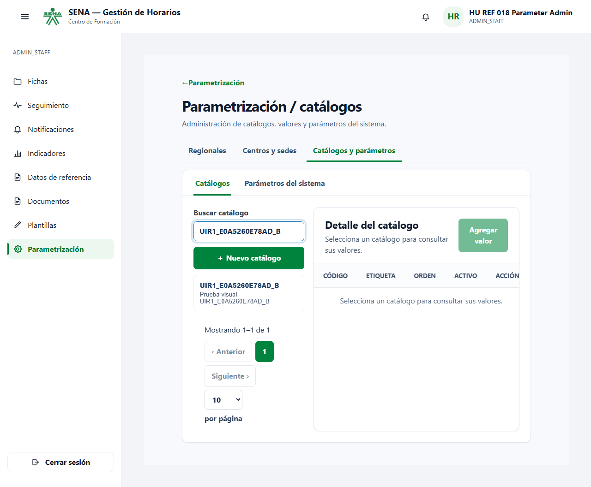
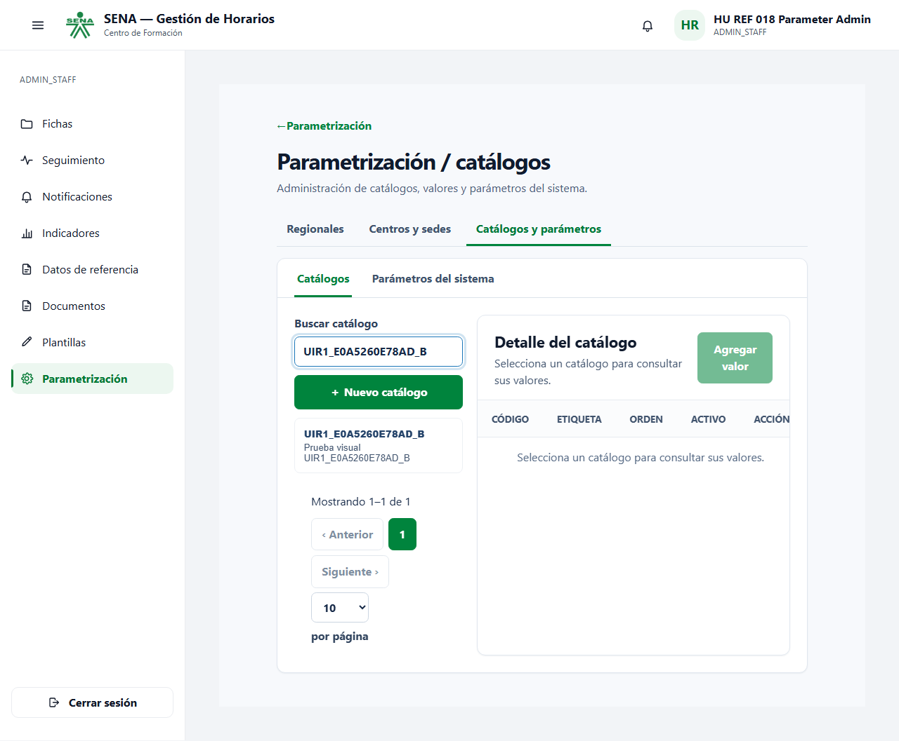

# Resultado: frontend real, HU-REF-020 y R1

Fecha de finalización: **19/10/2026 17:33:57, Colombia (UTC-5)**. Identificador de la prueba visual: `E0A5260E78AD`.

## Entorno y alcance

Perfil Compose `frontend-reference` sobre el proyecto aislado `r1-reference`. Web-shell y reference-mfe corrieron en contenedores Node 24 Alpine, construidos desde las fuentes actuales; PostgreSQL 16, IAM con JDK 21/reactor Maven y RabbitMQ 3.13 reales. El remote se cargó por Module Federation dentro de web-shell y el navegador Chromium inició sesión contra IAM. No se usó la identidad fija del BFF ni datos demo para el flujo evaluado. Los otros dominios no se desplegaron ni se consideran validados.

Comando verificado desde docker-infra:

```powershell
./validation/frontend-reference/run.ps1 -SkipBackendPreparation
```

El backend ya estaba migrado y preparado mediante la entrega R1. Para un entorno nuevo, ejecutar el mismo comando sin `-SkipBackendPreparation`. El runner recrea los contenedores frontend para no reutilizar una copia anterior de las fuentes, verifica endpoints y exige PASS explícito en backend y cero skips en navegador.

## Pruebas Go reales

| Prueba | Estado | Tiempo de la prueba |
|---|---|---|
| `TestHURef020ParametersWithRealIAMJWT` | PASS | 1.69s |
| `TestR1TransactionalOutbox` | PASS | 0.05s |
| `TestR1AtomicInboxAndDLQ` | PASS | 7.63s |

Se comprobaron claims/issuer/sub/exp/roles/features del JWT, administrador GET 200 / POST 201 / PUT 200, aprendiz GET/POST/PUT 403, ausencia de token/token malformado/firma alterada 401. R1 comprobó commit y rollback de negocio+outbox, doce entregas concurrentes con un efecto, rollback atómico de inbox, reintentos 1/2/4 segundos, DLQ y replay real conservando el event_id.

## Pruebas Chromium

| Escenario | Estado | Tiempo de la prueba |
|---|---|---|
| HU-REF-020: IAM login, real parameter create/update, persistence and logout | PASS | 4.37 s |
| HU-REF-020: learner cannot access parameter UI or protected API; missing/invalid JWT rejected | PASS | 3.14 s |
| R1: UI business writes survive broker outage/restart and duplicate event delivery | PASS | 55.35 s |

El primer escenario crea un parámetro por formulario, edita su valor, recarga y vuelve a consultar el valor persistido. Comprueba logout IAM 204 y eliminación del token local. El segundo comprueba que el aprendiz conserva lectura de catálogos, no puede gestionar catálogos ni abrir parámetros y recibe 403 al solicitar parámetros directamente; sin JWT o con JWT inválido recibe 401.

## Caos iniciado desde la interfaz

1. Catálogo A creado por formulario con JWT de administrador; se espera el primer efecto.
2. RabbitMQ detenido realmente; catálogo B creado por formulario y guardado en PostgreSQL junto a su outbox. Mientras el broker está detenido, B todavía tiene cero proyecciones.
3. Reference Data reiniciado con RabbitMQ detenido. B sigue visible al recargar y buscar desde web-shell.
4. RabbitMQ recuperado; se esperan ambos efectos.
5. Los dos registros outbox se ponen otra vez en `pending` exclusivamente para la prueba; el relay republica los mismos IDs y cuerpos. Se espera una barrera FIFO posterior antes de medir.

| Métrica de A/B | Resultado |
|---|---:|
| Eventos originales | 2 |
| Registros inbox del consumidor | 2 |
| Efectos aplicados | 2 |
| Reenvíos deliberados | 2 |
| Eventos perdidos en el escenario | 0 |
| Efectos duplicados | 0 |

El catálogo adicional de barrera tiene su propio evento y se excluye de estas métricas. Este conteo es distinto del escenario backend R1 anterior de seis originales y doce duplicados.

Salida del verificador:

```text
R1 UI: run=E0A5260E78AD, original_events=2, inbox=2, effects=2, deliberate_duplicates=2, lost=0, duplicate_effects=0; extra fence excluded
```

## Capturas revisadas

Parámetro creado, editado y consultado nuevamente después de recargar:



Vista del aprendiz: lectura de catálogos y parámetros deshabilitados:



Catálogo B guardado mientras RabbitMQ estaba detenido:



Catálogo B después del reinicio y recuperación del broker:



Las capturas muestran la operación de negocio. Las aserciones del verificador y las consultas a PostgreSQL prueban el estado de outbox/inbox/proyección; una captura por sí sola no demuestra entrega del evento. Los nombres HU REF 018 pertenecen a fixtures heredadas; la historia evaluada es HU-REF-020.

## Verificación adicional y límites

- Frontend-platform: typecheck y **32 pruebas unitarias** en verde.
- Reference-data-mfe: build, lint y **70 pruebas** en verde.
- Web-shell: build en modo reference, lint, tipos E2E, guard de tokens y **106 pruebas** en verde. El guard usa el snapshot de design-system, verificado idéntico al CSS canónico del repositorio docs.
- Tres escenarios Chromium y tres pruebas backend completadas sin skips; `evidence/result.json` registra `status: passed`, `browser_passed: 3`, `backend_passed: 3`, `skipped: 0`.
- R1 sigue siendo procesamiento al menos una vez con efecto idempotente sobre la proyección; no se afirma entrega única universal ni alta disponibilidad ante destrucción permanente del disco.
- No se añadió renovación automática del JWT ni un panel de administración de RabbitMQ. Las credenciales, resultados crudos, trazas, videos y HAR no forman parte de los archivos publicados.
- Esta integración cambia web-shell, frontend-platform, reference-data-mfe y docker-infra en `hu-ref-020-integracion-visual`. Reutiliza las entregas previas de IAM/backend/migraciones; no requiere cambios nuevos en IAM Service, las bases, web-bff ni design-system.

ADR compartido: `docs/adr/ADR-HU-REF-020-real-frontend-integration.md` en web-shell. La aprobación/fusión de los PR y la sustentación individual se verifican por separado; este informe acredita las pruebas descritas.
